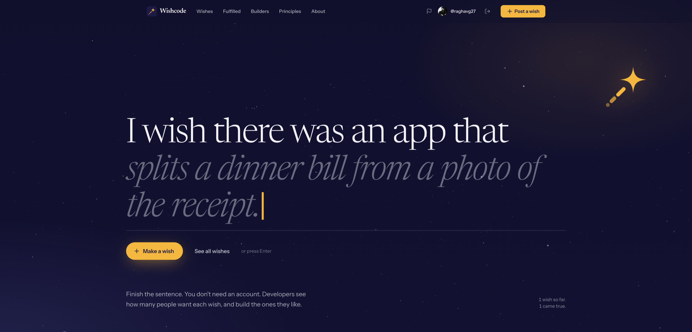
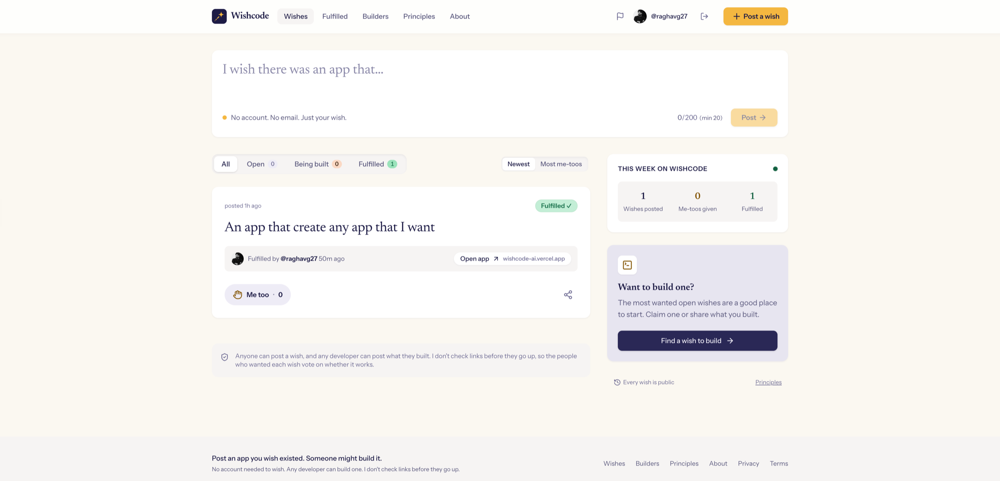

# Wishcode

**People post the apps that they want. Developers build them.**

[**Open Wishcode →**](https://wishcode-ai.vercel.app/)

 

---

Wishcode is a public list of app wishes. A wish is one sentence about an app that does not exist. For example: *"An app that mutes my mic when the dog starts barking."*

Each wish shows how many people want the app, which developers build it and what they finish. The people who want the app decide if it works.

## How it works

1. **Make a wish.** Complete the sentence *"I wish there was an app that…"*. You do not have to make an account.
2. **Add a me-too.** Each me-too shows developers how many people want the app.
3. **Build it.** A developer connects GitHub, claims the wish and posts a live link.
4. **Verify it.** The people who want the app examine the link. If the wisher says Yes, or if 3 me-too visitors say Yes, the wish shows **Fulfilled ✓**.

  

## Features

### For wishers

- **No account.** A wish is one sentence of 20 to 200 characters.
- **Duplicate suggestions.** Before you post, Wishcode shows wishes with the same meaning, not only the same words. You can add a me-too to that wish, or post your wish anyway.
- **Email when it is built.** Give an email address if you want. Wishcode sends you an email when a developer posts a live link.
- **A share card when your wish comes true.**

### For developers

- **Sign in with GitHub.** Your profile shows your claims and the apps that you finish.
- **Claims do not lock a wish.** Many developers can claim the same wish. Claims do not expire. You can post a link without a claim.
- **Email when your app is verified.**
- **A share card that shows the demand.** For example: *"I built what 214 people wished for."*

### For everyone

- **Public demand.** Each wish shows its me-too count, its claims and its live links.
- **Community verification.** The wisher's vote decides. If the wisher does not vote, 3 votes decide. If the votes flag a link, Wishcode folds the link away and shows a warning.
- **Filters.** Show all wishes, or only open, being built or fulfilled wishes. Sort by newest or by top.

## Security and privacy

Visitors post wishes without an account. Thus, Wishcode keeps very little data, and the server controls all access to that data.

**Your data**

- **No account for wishers.** Your device receives a random token in a cookie. The database keeps only a hash of that token.
- **No IP addresses.** For rate limits, Wishcode uses a salted hash of your IP address. The hash expires within one day.
- **Email only for notifications.** Wishcode uses your email address only to tell you about your wish. Each email has an unsubscribe link and supports one-click unsubscribe.
- **Email links are safe to open.** A link alone changes nothing, because mail scanners open all links. You must click the button on the page.
- **Developer avatars come only from GitHub.** Other image hosts cannot see the IP addresses of visitors.

**The system**

- **The browser has no database access.** Row-level security is on for all tables, with no policies. All reads and writes go through server functions.
- **Admin rights use GitHub user IDs, not handles.** A different person cannot receive admin rights with a renamed handle.
- **Bot protection.** Cloudflare Turnstile examines each new wish. Most visitors do not see the check.
- **Rate limits.** Limits apply to each device, each network and each developer. If a write goes over a limit, the database rolls it back.
- **Safe external links.** Links open in a new tab with `noopener noreferrer nofollow ugc`. Wishcode never shows them in an iframe. Each link shows who posted it.
- **Strict security headers.** Wishcode sends HSTS, `frame-ancestors 'none'`, `nosniff`, a strict referrer policy and a permissions policy.

**Moderation**

- Any visitor can report a wish or a link.
- Reports do not hide content automatically. The admin examines each report and removes the content or dismisses the report.

Wishcode uses PostHog for product analytics. For the full details, read the [privacy policy](https://wishcode-ai.vercel.app/privacy) and the [terms of use](https://wishcode-ai.vercel.app/terms).

### Report a vulnerability

Do not open a public issue for a security problem. Send an email to [raghavg2705@gmail.com](mailto:raghavg2705@gmail.com).

## Fair use

| Action | Limit each day |
| --- | --- |
| Wishes | 2 for each device (20 for each shared network) |
| Me-toos | 100 for each device (1,000 for each shared network) |
| Claims | 5 for each developer |
| Live links | 20 for each developer |
| Email sign-ups | 20 for each device (100 for each shared network) |

All limits start again at midnight UTC.

## Built with

Next.js 16, React 19, TypeScript, Tailwind CSS v4, Supabase (Postgres, pgvector and GitHub OAuth), Cloudflare Turnstile and Vercel.

To run your own copy, read [SELF_HOSTING.md](SELF_HOSTING.md).

## Feedback

- For problems and ideas, [open an issue](https://github.com/raghavg27/wishcode/issues).
- For other questions, send an email to [raghavg2705@gmail.com](mailto:raghavg2705@gmail.com).

## License

The code is available under the [MIT License](LICENSE).

The Wishcode name and logo are not part of the MIT License. If you deploy your own copy, use a different name and logo.

The Inter and Newsreader fonts in `assets/fonts/` are available under the [SIL Open Font License 1.1](assets/fonts/OFL.txt).

---

Made in India, for the world. This README uses <a href="https://www.asd-ste100.org">ASD-STE100 Simplified Technical English</a>.

