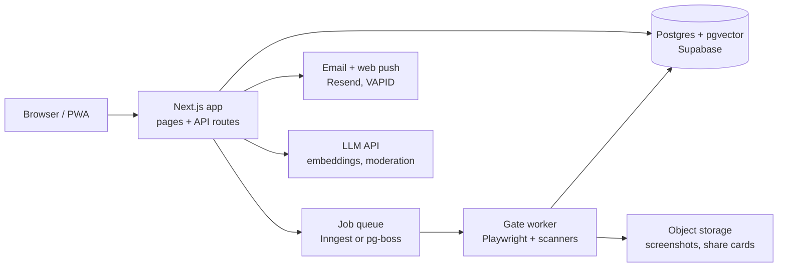
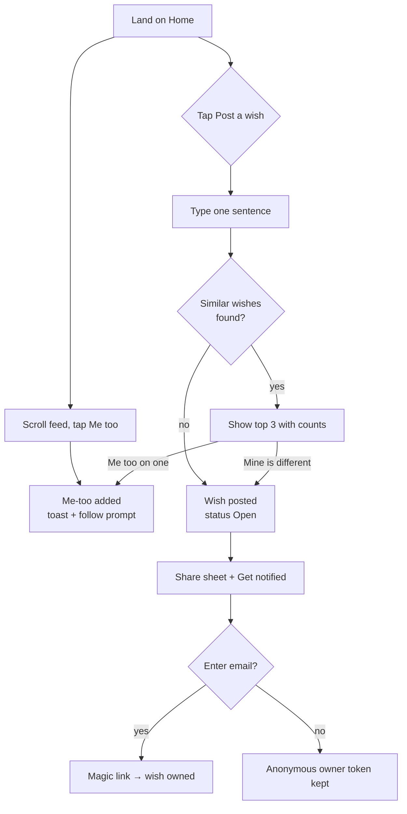
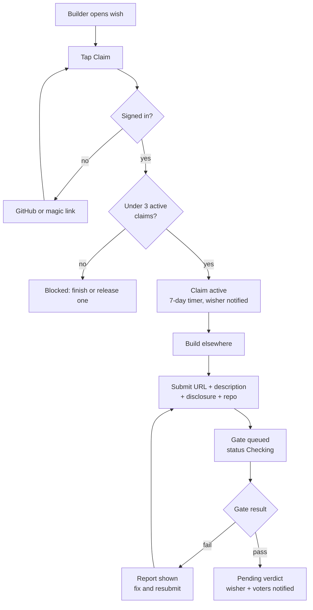
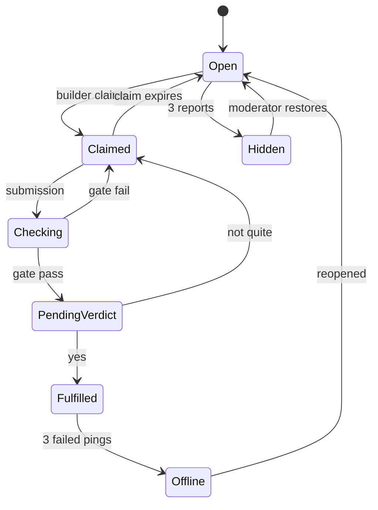

# Wishcode — PRD, TRD & App Flow

Sep 21, 2026 · @Raghav

## 1. PRD — Product Requirements

Wishcode is a demand-side network for software: anyone posts a one-sentence software wish, others add "me too", builders ship it, and every fulfilled wish becomes a shareable card. The v1 goal is 10,000 wishes and 100 fulfilled apps within 90 days of launch, on zero marketing spend.

### 1.1 Problem

Vibe-coding tools (Lovable, Bolt, Replit, Claude Code, Cursor) let millions of people ship an app in an afternoon, but those builders have no validated problems and no waiting users. Meanwhile billions of people have small, specific software wishes and no place to express them beyond a Reddit post that dies in a day. Every existing platform (Product Hunt, app stores, GitHub, Replit Bounties before it closed) is supply-side; nothing captures and ranks demand.

### 1.2 Goals and non-goals

| Goal | Measure |
| --- | --- |
| Wishes are effortless to post | Median time from landing to posted wish under 60 s, no signup required |
| Demand is visible and ranked | Every wish shows a live me-too count; home page ranks by it |
| Fulfilled apps are safe to use | 100% of "Fulfilled" apps pass the automated gate (loads, HTTPS, no exposed secrets, data disclosure filled) |
| Fulfilment is shareable | Every fulfilment generates an image card in under 2 s; 30% of fulfilments shared |
| Builders get users on day one | Every wisher and me-too voter is notified the moment a wish is fulfilled |

Non-goals for v1: payments between wishers and builders, hosting builders' apps, native mobile apps, a builder-to-wisher chat, company accounts.

### 1.3 Users

| Persona | Who | What they want | What they fear |
| --- | --- | --- | --- |
| Wisher | Anyone with a small software wish; mostly non-technical | Post in one sentence, see if others agree, get notified when it exists | Signup walls, spam, apps that steal data |
| Builder | Vibe-coder, indie dev, student, or agent operator | Validated problems with waiting users; a public record of shipped work | Building something nobody uses; unclear acceptance criteria |
| Voter | Visitor who tapped me-too | Tell someone "I'd use that"; get the app when it exists | Being asked to sign up for a one-tap action |
| Browser | Visitor from a shared card | See what got built, try it, post their own wish | A confusing landing page |

### 1.4 Features (v1 scope)

| # | Feature | Requirement | Priority |
| --- | --- | --- | --- |
| F1 | Post a wish | One text field, 20–200 chars, must start with or contain "I wish" pattern; optional tag; no login to post (anonymous token in browser); login only to claim ownership later | Must |
| F2 | Duplicate merge | On submit, show up to 3 semantically similar open wishes with me-too counts; one tap adds a me-too there instead of posting | Must |
| F3 | Me too | One tap, no login, rate-limited per device; count updates live | Must |
| F4 | Ranking | Home ranks open wishes by me-too velocity (last 7 days) with an "all time" toggle; tabs: Open, Claimed, Fulfilled | Must |
| F5 | Claim | A logged-in builder claims a wish; claim expires in 7 days unless a submission arrives; max 3 concurrent claims per builder; multiple builders may claim the same wish | Must |
| F6 | Submit | Builder submits hosted URL, one-line description, data disclosure form (what's stored, where, deletable?), optional repo link | Must |
| F7 | Fulfilment gate | Automated checks run on submission (section 2.5); pass → status Pending review; fail → returned with reasons | Must |
| F8 | Wisher confirm | Wisher and top voters get notified; wisher taps "Yes, this is it" or "Not quite" with a reason; two Yes votes from voters count if the wisher is silent for 72 h | Must |
| F9 | Share card | On Fulfilled, generate a 1200×630 PNG: wish text, me-too count, builder handle, hours from claim to ship, app URL as QR | Must |
| F10 | Builder profile | Handle, fulfilled count, average confirm rate, list of shipped apps | Must |
| F11 | Notifications | Email and web push for: wish claimed, wish fulfilled, submission failed gate, claim expiring | Must |
| F12 | Report | Any user can report a wish (spam, abuse) or an app (broken, unsafe); 3 reports auto-hide pending review | Must |
| F13 | Weekly digest | Email of top 10 new wishes and top 5 fulfilments | Should |
| F14 | Build-off weekends | Time-boxed event page with a leaderboard | Could |
| F15 | Seed import | Admin tool to import wishes scraped from public idea threads, marked "seeded" until a real user claims it | Should |

### 1.5 User requirements

- A wish must be readable in five seconds and describe an outcome, not a company ("I wish X would happen", not "a startup that").
- Nobody is forced to create an account to post, vote or try an app. Accounts exist for builders and for wishers who want ownership and notifications.
- Every fulfilled app shows its data disclosure before the user leaves Wishcode.
- Wishers can withdraw a wish only while it is unclaimed.
- Builders keep full ownership of what they ship; Wishcode holds a link and a snapshot, never the code.

### 1.6 Success metrics (90 days after launch)

| Metric | Target |
| --- | --- |
| Wishes posted | 10,000 |
| Wishes with 10+ me-toos | 1,000 |
| Fulfilled apps | 100 |
| Median claim-to-fulfil time | under 72 h |
| Share-card click-through to site | 15% |
| Gate pass rate on first submission | 60% (rising as builders learn the rules) |
| Reported-unsafe apps that reached Fulfilled | 0 |

### 1.7 Risks

| Risk | Mitigation |
| --- | --- |
| Vibe-coded apps leak data (a 2025 audit found 170 of 1,645 Lovable apps exposing personal data) | Fulfilment gate blocks exposed keys and open databases; disclosure is mandatory; "Fulfilled" badge is the brand |
| Wish spam and duplicates | Semantic merge on submit, device rate limits, 3-report auto-hide |
| Fulfilled apps die in six months | Weekly uptime ping; three failed pings move the app to "Offline" and reopen the wish; repo link earns a "source available" badge |
| Cold start on both sides | Seed 500 wishes from public idea threads; recruit 50 builders from vibe-coding communities before launch; first build-off weekend at launch |
| Builders and wishers fight over "not quite" | Wisher must give a reason; three "not quite" verdicts on one wish escalate to a moderator |

### 1.8 Monetisation (post v1, not built now)

Users never pay. Later revenue: demand data for companies ("4,000 people wished for X in your category"), a paid "first claim" window for builders on hot wishes, and sponsored wishes clearly labelled.

## 2. TRD — Technical Requirements

Wishcode v1 is a single Next.js app on Vercel with Postgres (Supabase), a queue-backed worker for the fulfilment gate, and no native clients. A solo builder can ship the MVP in one to two weeks; the gate worker is the only component with real engineering depth.

### 2.1 Architecture



The app serves pages and API routes; anything slower than 500 ms (embeddings, gate checks, card rendering, digests) goes through the queue to the worker.

### 2.2 Stack

| Layer | Choice | Why |
| --- | --- | --- |
| Frontend + API | Next.js 15, TypeScript, Tailwind | One repo, one deploy, server actions for forms, edge OG-image route for share cards |
| Database | Postgres on Supabase with pgvector | Relational core plus vector similarity for duplicate detection; row-level security for free |
| Auth | Supabase Auth: magic link, GitHub, Google | Builders sign in with GitHub; wishers with a magic link; anonymous device tokens for post and vote |
| Queue and workers | Inngest (or pg-boss on a small VM) | Durable retries for gate checks and notifications; cron for uptime pings and digests |
| Gate runtime | Playwright in a container (Fly.io or a Docker VM) | Headless load test, console and network capture, screenshot |
| Embeddings and moderation | An embeddings model (1,536-dim) plus a moderation endpoint | Duplicate merge, tag suggestion, spam and abuse filter |
| Email and push | Resend for email; Web Push (VAPID) for browser | No SMS in v1 |
| Storage | Supabase Storage or S3 | Screenshots and PNG share cards |
| Analytics | PostHog | Funnel: land → post → vote → claim → fulfil → share |
| Hosting | Vercel (app), Fly.io (gate worker) | Free tiers cover the first 10,000 users |

### 2.3 Data model

| Table | Key columns | Notes |
| --- | --- | --- |
| users | id, handle, email, github\_id, role (wisher, builder, admin), reputation, created\_at | Builders and wishers share one table; role is additive |
| devices | id, fingerprint\_hash, first\_seen, user\_id nullable | Anonymous identity for posting and voting before signup |
| wishes | id, text, embedding vector(1536), status (open, claimed, fulfilled, offline, hidden), author\_device\_id, author\_user\_id nullable, tag, seeded bool, metoo\_count, velocity\_7d, created\_at | metoo\_count and velocity\_7d are denormalised and recomputed by a cron every 10 min |
| metoos | wish\_id, device\_id, created\_at | Unique on (wish\_id, device\_id) |
| claims | id, wish\_id, builder\_id, status (active, expired, submitted), expires\_at | Partial unique index: one active claim per (wish\_id, builder\_id) |
| submissions | id, claim\_id, url, description, repo\_url nullable, disclosure jsonb, gate\_status (queued, pass, fail), gate\_report jsonb, verdict (pending, confirmed, rejected), created\_at | disclosure = {stores\_data, data\_types\[\], region, deletable, third\_parties\[\]} |
| verdict\_votes | submission\_id, device\_id, vote (yes, not\_quite), reason text | Wisher's vote weighted as 2; voters as 1 |
| apps | id, wish\_id, submission\_id, builder\_id, url, screenshot\_url, card\_url, last\_ping\_ok\_at, ping\_failures | Created on Fulfilled |
| reports | id, target\_type, target\_id, device\_id, reason, created\_at | 3 reports on one target set status hidden |
| notifications | id, user\_id or device\_id, kind, payload jsonb, sent\_at | Outbox pattern; worker drains it |

### 2.4 API surface (Next.js route handlers)

| Method and path | Purpose | Auth |
| --- | --- | --- |
| POST /api/wishes | Create a wish; returns wish or list of near-duplicates if similarity above 0.88 | Device token |
| POST /api/wishes/:id/metoo | Toggle me-too | Device token |
| GET /api/wishes?sort=velocity&status=open&cursor= | Feed, cursor-paginated | Public |
| POST /api/wishes/:id/claim | Claim; enforces max 3 active claims | Builder |
| POST /api/claims/:id/submit | Submit URL, description, disclosure; enqueues gate job | Builder |
| POST /api/submissions/:id/verdict | Yes or not\_quite with reason | Wisher or voter of that wish |
| GET /api/og/wish/:id and /api/og/app/:id | Share card PNG, rendered at the edge and cached | Public |
| POST /api/reports | Report a wish or app | Device token |
| GET /api/builders/:handle | Public profile | Public |

Every write route is rate-limited per device token (Upstash Redis or a Postgres counter): 5 wishes per day, 200 me-toos per day, 20 reports per day.

### 2.5 Fulfilment gate (the defensible part)

A submission is marked "gate pass" only when every check below passes. The worker runs them in order and stops at the first hard fail, returning the reasons to the builder.

| # | Check | Method | Fail condition | Severity |
| --- | --- | --- | --- | --- |
| G1 | Reachable | HTTP GET; Playwright load with 15 s timeout | Non-2xx, or no DOM after timeout | Hard |
| G2 | HTTPS only | Inspect URL and all first-party network requests | Any http:// first-party request | Hard |
| G3 | No exposed secrets | Regex scan of HTML, inline JS, and fetched first-party JS bundles for known key shapes (sk-, AKIA, service\_role JWTs, Firebase private keys, Stripe secret keys) | Any match | Hard |
| G4 | No open database | If a Supabase or Firebase project URL is found, attempt unauthenticated reads of the tables named in the bundle; check Firebase rules endpoint | Any unauthenticated read returns rows | Hard |
| G5 | Auth not bypassable | If the app has login, load a route the bundle marks protected without a session | 200 with content instead of redirect | Hard |
| G6 | Does what the wish says | LLM compares wish text, builder description, screenshot and visible DOM text; returns a 0–1 match score | Score under 0.5 | Soft (flag for reviewer) |
| G7 | Disclosure consistent | Compare disclosure form with observed third-party domains and storage calls (cookies, localStorage, IndexedDB, POSTs to external hosts) | Undeclared third-party domain receiving form data | Hard |
| G8 | Malware and phishing | Google Safe Browsing lookup; check for password fields on a domain that imitates a known brand | Any hit | Hard |
| G9 | Performance floor | Largest Contentful Paint on a throttled 4G profile | Over 8 s | Soft |

The report is stored as JSON and shown to the builder in full and to users as a summary badge (Passed 8/9, 1 warning). G4 and G5 touch third-party systems, so the worker only ever performs reads and only against a URL the builder submitted for exactly this purpose; that consent is recorded on the submission.

### 2.6 Duplicate detection

On submit the API embeds the wish text, runs a cosine similarity query against open and claimed wishes (pgvector HNSW index), and returns the top 3 above 0.88. The user chooses "add my me-too to that one" or "mine is different"; the second choice posts the wish and stores the rejected duplicate ids so moderators can tune the threshold. A nightly job clusters wishes above 0.94 and proposes merges to an admin queue.

### 2.7 Share cards

An edge route renders a 1200×630 PNG with Satori from the wish text, me-too count, builder handle, hours to ship and a QR code to the app. The PNG is cached at the CDN for 24 h and regenerated on any change to the underlying record. Every wish, app and builder page sets og:image to its card so links unfurl on X, WhatsApp, LinkedIn and Reddit without extra work.

### 2.8 Security and privacy

- Row-level security on every table; the service key is used only by the worker.
- Device fingerprint is a salted hash of a random cookie plus coarse UA, never IP, and is deletable from the settings page.
- Wish text passes a moderation endpoint before it is visible; flagged wishes go to a review queue, not the feed.
- Builders' submitted URLs are never iframed on Wishcode; every try-it link opens in a new tab with rel="noopener".
- Personal data stored: email (accounts only), device hash, wish text. No IP retention beyond 24 h of request logs.
- GDPR and India DPDP: export and delete endpoints on the settings page; data stored in one region (Supabase ap-south-1 or eu-central-1, pick one at setup).

### 2.9 Constraints and limits

| Constraint | Value |
| --- | --- |
| Wish length | 20–200 characters |
| Active claims per builder | 3 |
| Claim lifetime | 7 days |
| Gate run budget | 90 s per submission, 3 retries |
| Uptime ping | Weekly; 3 consecutive failures set app to Offline and reopen the wish |
| Feed latency | p95 under 300 ms from cache |
| Cost ceiling at 10,000 MAU | Under USD 50 per month on free and hobby tiers |

### 2.10 Scaling path

Nothing in v1 needs a second service. When me-too writes exceed roughly 50 per second, move counters to Redis with periodic flush. When gate jobs queue longer than 5 minutes, add worker replicas. When the feed exceeds a few million wishes, move ranking to a materialised view refreshed every minute. Native mobile is a wrapped PWA until retention justifies more.

### 2.11 Environments and delivery

Git main deploys to production on Vercel; every pull request gets a preview URL. The worker deploys from the same repo via a Dockerfile. Tests: Playwright end-to-end on the post → me-too → claim → submit → confirm path, plus unit tests for the gate scanners using a fixture set of intentionally broken sample apps (exposed key, open Supabase table, http asset). Treat the gate fixture set as the product's most valuable test asset.

## 3. App Flow

There are four entry points (home, a wish link, a share card, a builder profile) and two core loops: the wish loop (post → me-too → notified) and the build loop (claim → submit → gate → confirm → card). No screen asks for an account until the user tries to claim, own or be notified.

### 3.1 Screen map

| Screen | Route | Who lands here | Primary action |
| --- | --- | --- | --- |
| Home / Feed | / | Everyone | Post a wish; scroll ranked wishes; tap me-too |
| Wish detail | /w/:id | From feed, share, notification | Me-too; claim (builder); share |
| Post wish (inline sheet) | / (modal) | Wisher | Type, see duplicates, post or merge |
| Sign in | /login | Anyone taking an owned action | Magic link, GitHub, Google |
| Claim confirm (sheet) | /w/:id (modal) | Builder | Accept rules, start 7-day timer |
| Submit app | /w/:id/submit | Builder with active claim | URL, description, disclosure, repo |
| Gate result | /s/:id | Builder | Read pass/fail report; resubmit |
| Verdict | /s/:id/verdict | Wisher and voters (via notification) | Yes / Not quite + reason |
| App page | /a/:id | From card, feed "Fulfilled" tab | Try it (new tab); see disclosure and gate badge |
| Builder profile | /b/:handle | From card, app page | Browse shipped apps; follow |
| My wishes / My claims | /me | Signed-in user | Track status; withdraw; resubmit |
| Settings | /settings | Signed-in user | Notifications, export, delete |
| Admin queue | /admin | Admin | Moderation, merges, reports |

### 3.2 Wish loop (wisher and voter)



Posting never blocks on login; the email prompt appears once, after the wish exists, and is skippable. A voter who taps me-too three times in a session gets a single "want to know when these ship?" prompt.

### 3.3 Build loop (builder)



A claim expiring in 24 h triggers a reminder; on expiry the claim is released and the wish returns to Open, with the builder's partial work unaffected.

### 3.4 Verdict and fulfilment

```mermaid
sequenceDiagram
  participant W as Wisher
  participant V as Voters
  participant S as Wishcode
  participant B as Builder
  S->>W: Notify: an app claims to fulfil your wish
  S->>V: Notify top voters
  W->>S: Yes, this is it
  S->>S: Status Fulfilled, app record, share card rendered
  S->>B: Notify: fulfilled, here is your card
  S->>V: Notify all me-too voters: it exists, try it
  Note over W,S: If W silent 72 h, two Yes votes from V fulfil
  W-->>S: Not quite + reason
  S-->>B: Returned with reason; claim extended 3 days
```

Three "Not quite" verdicts on the same wish route it to the admin queue rather than looping forever.

### 3.5 Wish and submission states



A wish may have several active claims; the first submission to pass verdict wins, and the other claims close with a "someone shipped it" notice and a link.

### 3.6 Share card and inbound visitor

1. Fulfilled triggers card render; builder and wisher each get a download and one-tap share to X, WhatsApp, LinkedIn and Reddit.
2. A visitor opening the card link lands on the app page: wish text, count, builder, gate badge, disclosure summary, and a Try it button that opens the app in a new tab.
3. Below the fold: "Have a wish of your own?" with the post field inline, so the visitor can post without going to Home.
4. Every inbound card visit is attributed to the sharer in PostHog for the builder leaderboard.

### 3.7 Notifications

| Event | Wisher | Voters | Builder | Channel |
| --- | --- | --- | --- | --- |
| Wish claimed | Yes | No | — | Email, push |
| Gate failed | No | No | Yes | Email, push |
| Pending verdict | Yes | Top 5 | Yes | Email, push |
| Fulfilled | Yes | All | Yes | Email, push |
| Not quite | No | No | Yes | Email |
| Claim expiring in 24 h | No | No | Yes | Email, push |
| App offline | Yes | No | Yes | Email |
| Weekly digest | Opt-in | Opt-in | Opt-in | Email |

Anonymous wishers and voters with no email receive an in-app badge on their next visit instead.

### 3.8 Error and edge paths

- Wish under 20 chars or without an outcome → inline hint with two example wishes, no submit.
- Me-too on a hidden or offline wish → disabled with a one-line reason.
- Claim on an already fulfilled wish → "Build a better one" path that opens a new claim flagged as an alternative.
- Submitted URL fails G1 (unreachable) → instant fail without queuing the rest.
- Builder deletes their account → their apps stay listed as "builder left", disclosure and gate report kept, wishes they posted stay.
- Wisher withdraws an unclaimed wish → me-toos are refunded to voters' daily quota and the wish is soft-deleted.
