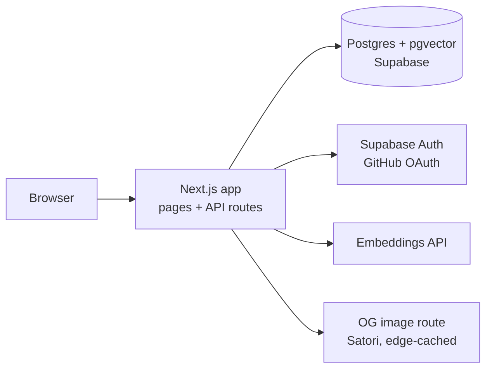
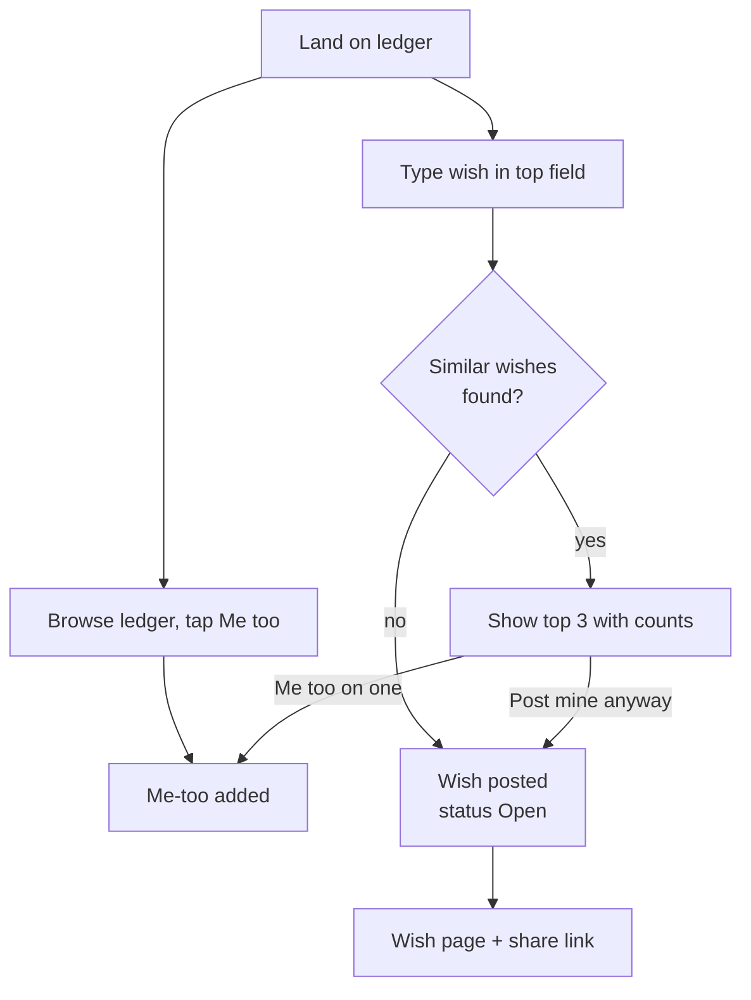
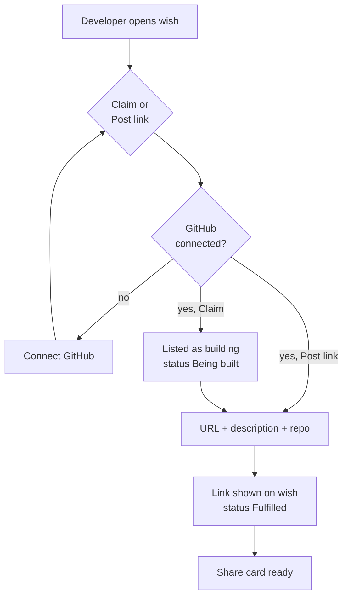
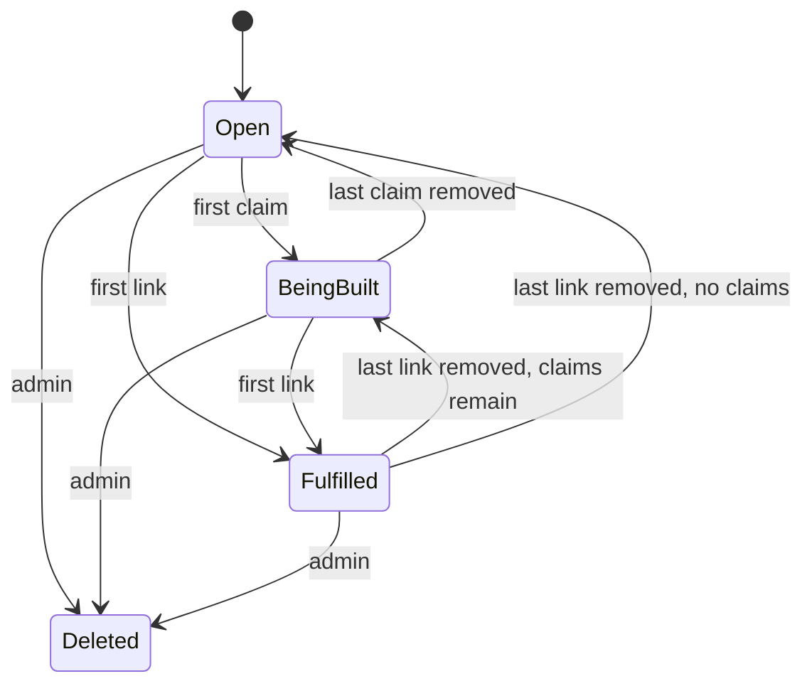

# Wishcode v1: PRD, TRD & App Flow

Oct 11, 2026 · @Raghav

This is the cut-down first version. The full long-term vision is in `Wishcode — PRD, TRD & App Flow.md`.

## 1. PRD: Product Requirements

Wishcode v1 is a public ledger of software wishes. Anyone can post a one-sentence wish without signing up. Developers who connect GitHub can claim a wish or post a live link to an app that does what it asks. A wish is **Fulfilled** as soon as a developer posts a live link. Nothing is checked, reviewed or confirmed first.

### 1.1 Core idea

- **Posting a wish is the main action.** One text field on the home page, no account, no email.
- **The public ledger is the main surface.** Anyone can see every wish, its me-too count, who is building it and every live link posted against it, without logging in.
- **Fulfilled means a live link exists.** There are no gate checks, no security scans, no wisher confirmation and no voting on whether the app counts.

### 1.2 Goals and non-goals

| Goal | Measure |
| --- | --- |
| Posting a wish is effortless | Median time from landing to a posted wish under 60 s, no signup |
| Demand is public and visible | Every wish on the ledger shows its me-too count and status |
| Developers can ship against demand | A developer goes from GitHub connect to a posted link in under 2 minutes |
| Fulfilment is shareable | Every fulfilled wish has a share card and a developer profile to link to |

Non-goals for v1: any fulfilment gate or automated checks, wisher confirmation or verdicts, wisher accounts or emails, notifications of any kind, public reporting, payments, claim expiry or claim limits, hosting apps, native mobile apps, digests, build-off events, seed imports.

### 1.3 Users

| Persona | Account | Can do |
| --- | --- | --- |
| Wisher | None (anonymous device token) | Post a wish, me-too wishes, browse the ledger |
| Visitor | None (anonymous device token) | Browse the ledger, me-too, open live links, post their own wish |
| Developer | GitHub connected (required) | Everything above, plus claim wishes and post live links |
| Admin | GitHub account on an allowlist | Delete spam wishes and bad links |

### 1.4 Features (v1 scope)

| # | Feature | Requirement |
| --- | --- | --- |
| F1 | Post a wish | One text field, 20–200 chars, placeholder "I wish there was an app that…"; no login and no email; tied to an anonymous device token |
| F2 | Duplicate suggestions | On submit, show up to 3 similar existing wishes with their me-too counts; the user can me-too one of those instead, or post anyway |
| F3 | Me too | One tap, no login, one per device per wish, toggleable |
| F4 | Public ledger | Home page lists every wish; filters: All, Open, Being built, Fulfilled; sort: Newest, Most me-toos |
| F5 | Connect GitHub | GitHub OAuth is the only sign-in and is for developers only; it is required before claiming or posting a link |
| F6 | Claim (optional) | A public "I'm building this" signal. No expiry, no limit, and many developers can claim one wish. A developer can unclaim. Claiming is never required before posting a link |
| F7 | Post live link | A developer posts a URL (https only), a one-line description and an optional repo URL. One link per developer per wish. The first link marks the wish Fulfilled. Other developers can still add links, and all of them show |
| F8 | Share card | Every fulfilled wish gets a 1200×630 OG image with the wish text, me-too count, the first developer's GitHub handle and avatar, and the app URL |
| F9 | Developer profile | Public page built from GitHub: handle, avatar, links posted, wishes claimed |
| F10 | Rate limits | Per device: 5 wishes a day, 200 me-toos a day. Per developer: 20 links a day |
| F11 | Admin delete | An allowlisted admin can soft-delete a wish or a link; nobody else can delete anything except a developer removing their own link or claim |

### 1.5 Rules

- Nobody needs an account to post, me-too or browse.
- Only a developer with GitHub connected can claim or post a link.
- A wish's status comes only from its claims and links: **Open** (no claims, no links), **Being built** (at least one claim, no links), **Fulfilled** (at least one link).
- If every link on a wish is removed, it goes back to Being built or Open.
- Links always open in a new tab with `rel="noopener noreferrer"`. Every wish page shows a line saying Wishcode does not check or vouch for linked apps.
- Wishers cannot edit or withdraw a wish in v1. Wishes are permanent unless an admin removes them.

### 1.6 Success metrics (90 days after launch)

| Metric | Target |
| --- | --- |
| Wishes posted | 10,000 |
| Wishes with 10+ me-toos | 1,000 |
| Fulfilled wishes | 100 |
| Developers with GitHub connected | 500 |
| Share-card click-through to site | 15% |

### 1.7 Risks

| Risk | Mitigation |
| --- | --- |
| Spam wishes with anonymous posting | Device rate limits; admin delete |
| Malicious or broken live links, since nothing is checked | GitHub identity on every link; visible "not checked" disclaimer; links open in a new tab; admin delete |
| Wishers never learn their wish was fulfilled | Accepted for v1. Wishes are permalinks, and the ledger and share cards carry discovery |
| Duplicate wishes split the demand | Duplicate suggestions on submit |
| Cold start on both sides | Recruit developers from vibe-coding communities before launch |

## 2. TRD: Technical Requirements

v1 is a single Next.js app on Vercel with Supabase (Postgres, pgvector, GitHub auth). It has no queue, no worker and no notification system. The only external call on the write path is one embedding call when a wish is posted.

### 2.1 Architecture

### 2.2 Stack

| Layer | Choice | Why |
| --- | --- | --- |
| Frontend + API | Next.js, TypeScript, Tailwind | One repo, one deploy |
| Database | Postgres on Supabase with pgvector | Relational core plus similarity search for duplicate suggestions |
| Auth | Supabase Auth, GitHub provider only | Developers only; gives the handle, avatar and GitHub id |
| Anonymous identity | Random device token in an httpOnly cookie, stored hashed | Posting and me-too without signup |
| Embeddings | An embeddings model (1,536-dim), called synchronously on submit | Duplicate suggestions |
| Share cards | Next.js OG image route (Satori), CDN-cached | No storage needed |
| Rate limiting | Postgres counters (or Upstash Redis) | Per device and per developer |
| Hosting | Vercel + Supabase free/hobby tiers | Low cost at launch |
| Analytics | PostHog | Funnel: land → post → me-too → claim → link → share |

### 2.3 Data model

| Table | Key columns | Notes |
| --- | --- | --- |
| devices | id, token\_hash, created\_at | Anonymous identity; never linked to a person |
| developers | id, github\_id, github\_handle, avatar\_url, is\_admin, created\_at | Created on first GitHub connect; `is_admin` set from an env allowlist |
| wishes | id, text, embedding vector(1536), status (open, being\_built, fulfilled), device\_id, metoo\_count, created\_at, fulfilled\_at, deleted\_at | `status` and `metoo_count` are denormalised and updated in the same transaction as claims, links and me-toos |
| metoos | wish\_id, device\_id, created\_at | Primary key (wish\_id, device\_id) |
| claims | wish\_id, developer\_id, created\_at | Primary key (wish\_id, developer\_id); no expiry |
| links | id, wish\_id, developer\_id, url, description, repo\_url nullable, created\_at, deleted\_at | Unique (wish\_id, developer\_id) where not deleted |

### 2.4 API surface

| Method and path | Purpose | Auth |
| --- | --- | --- |
| POST /api/wishes | Create a wish. Returns up to 3 similar wishes (cosine ≥ 0.88) unless `force=true` | Device token |
| GET /api/wishes?status=&sort=&cursor= | Ledger feed, cursor-paginated | Public |
| GET /api/wishes/:id | Wish with claims and links | Public |
| POST /api/wishes/:id/metoo | Toggle me-too | Device token |
| POST / DELETE /api/wishes/:id/claim | Claim or unclaim | Developer |
| POST /api/wishes/:id/links | Post a live link (https URL, description, optional repo) | Developer |
| DELETE /api/links/:id | Remove a link | Link owner or admin |
| DELETE /api/wishes/:id | Soft-delete a wish | Admin |
| GET /api/og/wish/:id | Share card PNG | Public |
| GET /api/developers/:handle | Developer profile | Public |

### 2.5 Duplicate suggestions

On submit the API embeds the text and runs a cosine similarity query against non-deleted wishes (pgvector HNSW index). If any score 0.88 or above, it returns the top 3 instead of creating the wish. The client shows them with "Me too on this one" or "Post mine anyway", and the second option resubmits with `force=true`.

### 2.6 Link validation (input only, not a gate)

The server only checks that the URL parses, uses `https://` and is under 2,048 chars, and that the description is 1–140 chars. The server does not fetch, crawl or scan the linked app.

### 2.7 Security and privacy

- Row-level security on every table. Writes go through API routes that check the device token or the developer session.
- The device token is a random value in an httpOnly cookie, and only its hash is stored. No IP retention beyond standard request logs.
- Personal data stored: GitHub id, handle and avatar for developers only. Wishers are fully anonymous.
- Links are never iframed. They open in a new tab with `rel="noopener noreferrer"`.

### 2.8 Constraints

| Constraint | Value |
| --- | --- |
| Wish length | 20–200 characters |
| Link description | 1–140 characters |
| Links per developer per wish | 1 |
| Wishes per device per day | 5 |
| Me-toos per device per day | 200 |
| Links per developer per day | 20 |
| Feed latency | p95 under 300 ms |

## 3. App Flow

There are three entry points: the ledger (home), a wish link and a developer profile. The only screen that asks for anything is the GitHub connect, and it appears only when someone tries to claim or post a link.

### 3.1 Screen map

| Screen | Route | Primary action |
| --- | --- | --- |
| Ledger (home) | / | Post a wish (field at top); browse, filter, sort; me-too |
| Wish detail | /w/:id | Me-too; claim; post live link; open links; share |
| Connect GitHub | /login | GitHub OAuth (developers only) |
| Developer profile | /d/:handle | See a developer's links and claims |
| Admin | /admin | Delete wishes and links |

### 3.2 Wisher flow

### 3.3 Developer flow

### 3.4 Wish states

### 3.5 Edge paths

- Wish under 20 or over 200 chars → inline hint, submit disabled.
- Rate limit hit → "You've posted 5 wishes today, try again tomorrow."
- Non-https or malformed link → inline error, no submit.
- A developer posts a second link on the same wish → blocked; they can remove their existing link and post a new one.
- Me-too on a deleted wish → the wish page shows "Removed" and actions are disabled.
- A developer revokes GitHub access → their links and claims stay listed under their handle.
