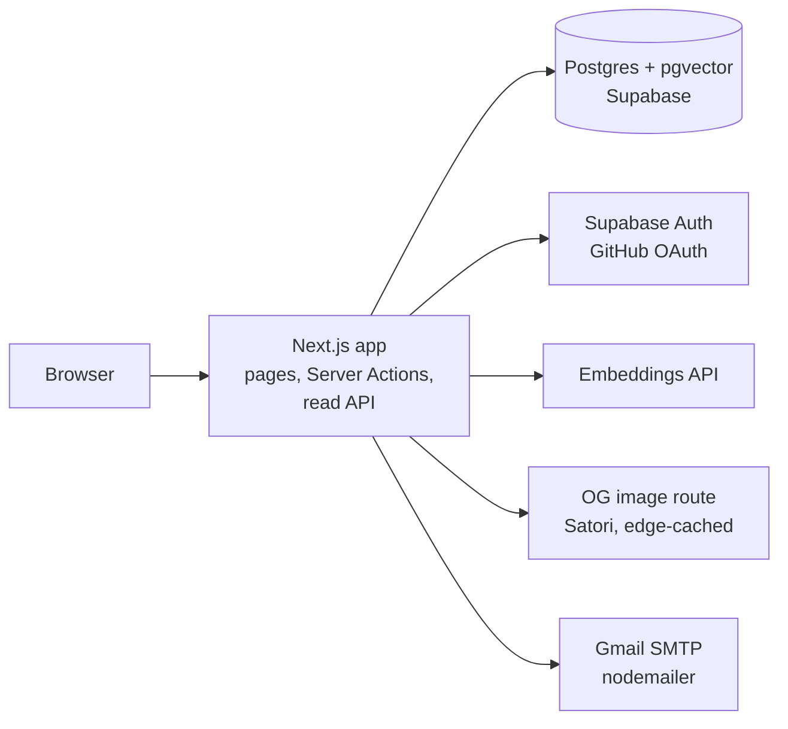
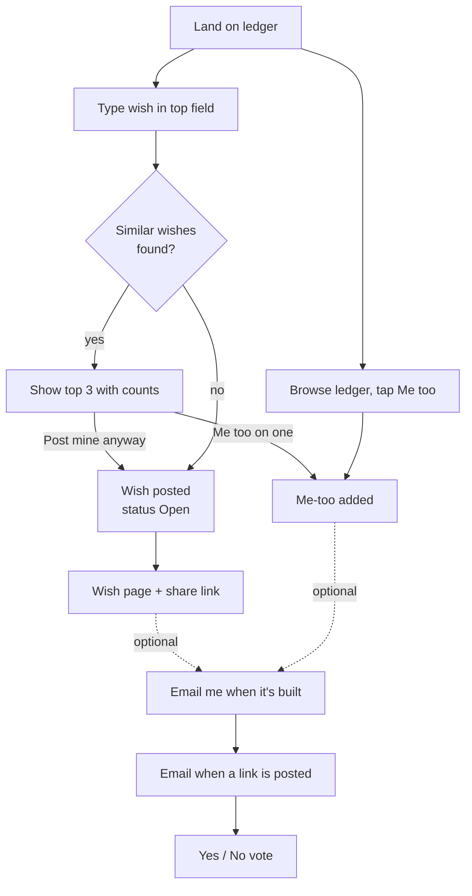
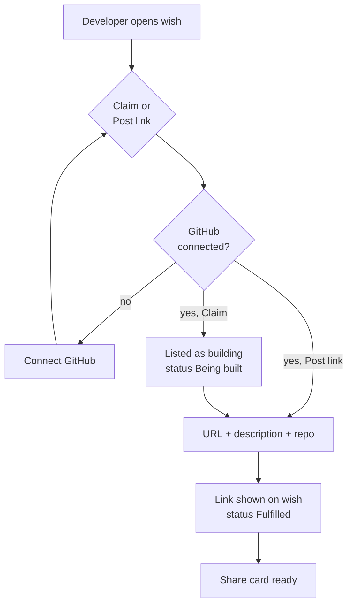
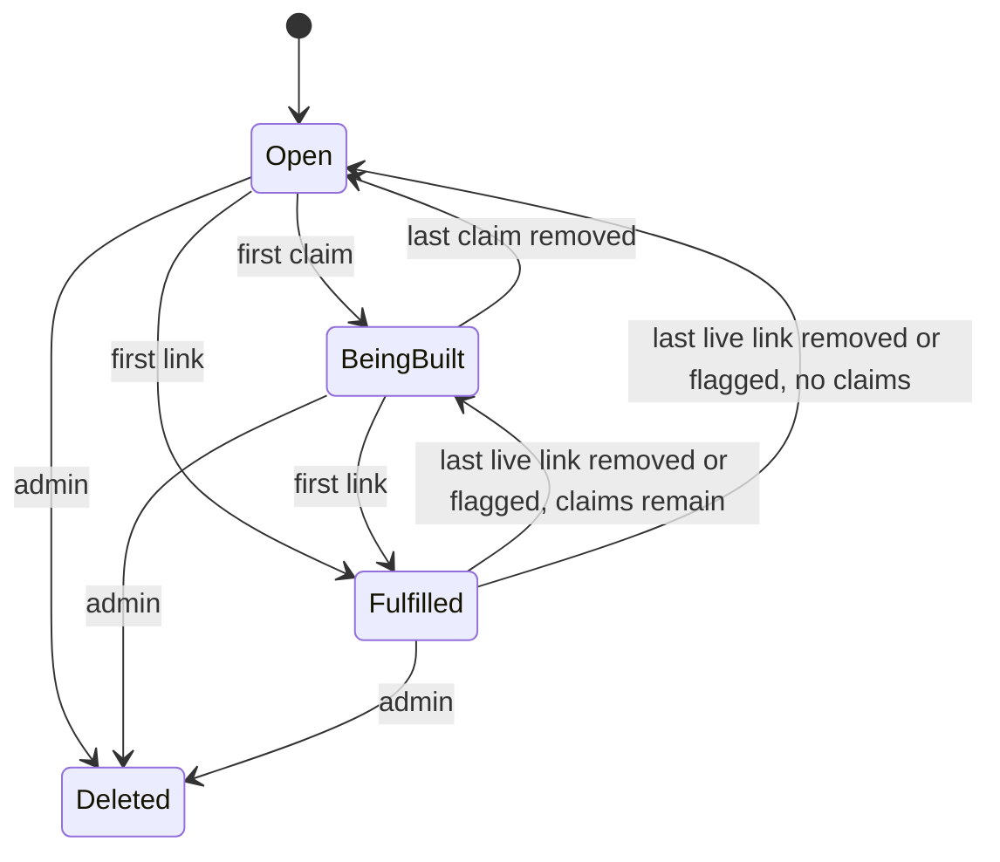

# Wishcode v1: PRD, TRD & App Flow

Oct 11, 2026 · @Raghav

This is the cut-down first version. The full long-term vision is in `Wishcode — PRD, TRD & App Flow.md`.

## 1. PRD: Product Requirements

Wishcode v1 is a public ledger of software wishes. Anyone can post a one-sentence wish without signing up. Developers who connect GitHub can claim a wish or post a live link to an app that does what it asks. A wish is **Fulfilled** as soon as a developer posts a live link. Nothing is checked before it shows. Afterwards, the people who wanted the wish vote on whether each link works, and anyone who opted in gets an email when a link is posted.

### 1.1 Core idea

- **Posting a wish is the main action.** One text field on the home page, no account, no email.
- **The public ledger is the main surface.** Anyone can see every wish, its me-too count, who is building it and every live link posted against it, without logging in.
- **Fulfilled means a live link exists, and the people who wanted it say whether it works.** There are no gate checks or security scans. The wisher, or 3 people who me-too'd, can verify a link (**Fulfilled ✓**) or flag it as not working.

### 1.2 Goals and non-goals

| Goal | Measure |
| --- | --- |
| Posting a wish is effortless | Median time from landing to a posted wish under 60 s, no signup |
| Demand is public and visible | Every wish on the ledger shows its me-too count and status |
| Developers can ship against demand | A developer goes from GitHub connect to a posted link in under 2 minutes |
| Fulfilment is shareable | Every fulfilled wish has a share card and a developer profile to link to |

Non-goals for v1: any fulfilment gate or automated checks, wisher accounts, email confirmation, notifications other than one email per new link, email digests or retries, public reporting, payments, claim expiry, hosting apps, native mobile apps, digests, build-off events, seed imports.

### 1.3 Users

| Persona | Account | Can do |
| --- | --- | --- |
| Wisher | None (anonymous device token) | Post a wish, me-too wishes, browse the ledger, vote on links to their wish, opt in to email |
| Visitor | None (anonymous device token) | Browse the ledger, me-too, open live links, post their own wish; after a me-too, vote on that wish's links and opt in to email |
| Developer | GitHub connected (required) | Everything above, plus claim wishes and post live links |
| Admin | GitHub account on an allowlist | Delete spam wishes and bad links |

### 1.4 Features (v1 scope)

| # | Feature | Requirement |
| --- | --- | --- |
| F1 | Post a wish | One text field, 20–200 chars, placeholder "I wish there was an app that…"; no login and no email; tied to an anonymous device token |
| F2 | Duplicate suggestions | On submit, show up to 3 similar existing wishes with their me-too counts; the user can me-too one of those instead, or post anyway |
| F3 | Me too | One tap, no login, one per device per wish, toggleable. A new wish starts at zero me-toos: the wisher does not get one automatically |
| F4 | Public ledger | Home page lists every wish; filters: All, Open, Being built, Fulfilled; sort: Newest, Most me-toos |
| F5 | Connect GitHub | GitHub OAuth is the only sign-in and is for developers only; it is required before claiming or posting a link |
| F6 | Claim (optional) | A public "I'm building this" signal. No expiry, and many developers can claim one wish. A developer can unclaim. Claiming is never required before posting a link |
| F7 | Post live link | A developer posts a URL (https only), a one-line description and an optional repo URL. One link per developer per wish. The first link marks the wish Fulfilled. Other developers can still add links, and all of them show |
| F8 | Share card | Every fulfilled wish gets a 1200×630 OG image with the wish text, me-too count, the first developer's GitHub handle and avatar, and the app URL |
| F9 | Developer profile | Public page built from GitHub: handle, avatar, links posted, wishes claimed |
| F10 | Rate limits | Per device: 2 wishes and 100 me-toos a day. Per network (salted IP hash, shared by everyone behind one IP): 20 wishes and 1,000 me-toos a day. Per developer: 5 claims and 20 links a day. Daily limits reset at midnight UTC. Duplicate checks: 60 per IP per hour |
| F11 | Admin delete | An allowlisted admin can soft-delete a wish or a link; nobody else can delete anything except a developer removing their own link or claim. A removed wish keeps its page and number, but its text is hidden everywhere and its actions are disabled |
| F12 | Link verdicts | The wisher and anyone who me-too'd a wish can vote **works** or **doesn't work** on each of its links, and change or clear the vote. The wisher's vote decides on its own. Otherwise 3 works votes (more than doesn't-work votes) verify a link, and 3 doesn't-work votes (at least as many as works votes) flag it. Flagged links collapse behind "People say this doesn't work" and sort last. Taking back a me-too removes that device's votes on the wish |
| F13 | Wish emails | The wisher (after posting) and me-too-ers (after a me-too) can leave an email to hear when someone builds the wish. No confirmation step. Every new live link emails each subscriber once, with Yes / No vote buttons and unsubscribe links (this wish, or all Wishcode emails). Claims never email. Taking back a me-too ends that subscription |

### 1.5 Rules

- Nobody needs an account to post, me-too or browse.
- Only a developer with GitHub connected can claim or post a link.
- A wish's status comes only from its claims and its live links (links that aren't removed or flagged): **Open** (no claims, no live links), **Being built** (at least one claim, no live links), **Fulfilled** (at least one live link). A Fulfilled wish shows **Fulfilled ✓** once any link is verified, otherwise **Fulfilled · unverified**.
- If every link on a wish is removed or flagged, it goes back to Being built or Open. A flagged link that becomes verified restores Fulfilled.
- Links always open in a new tab with `rel="noopener noreferrer"`. Every wish page shows a line saying Wishcode does not check linked apps and that people who wanted the wish vote on whether each link works.
- Wishers cannot edit or withdraw a wish in v1. Wishes are permanent unless an admin removes them.

### 1.6 Success metrics (90 days after launch)

| Metric | Target |
| --- | --- |
| Wishes posted | 10,000 |
| Wishes with 10+ me-toos | 1,000 |
| Fulfilled wishes | 100 |
| Developers with GitHub connected | 500 |
| Share-card click-through to site | 15% |

### 1.7 Risks

| Risk | Mitigation |
| --- | --- |
| Spam wishes with anonymous posting | Per-device and per-network rate limits; admin delete |
| Malicious or broken live links, since nothing is checked | Wisher and me-too-er votes flag and collapse bad links; GitHub identity on every link; visible "not checked" disclaimer; links open in a new tab; admin delete |
| Fake verdicts from one person using several browsers | Accepted. Me-too limits per device and per network raise the cost; admin delete is the backstop |
| Wishers never learn their wish was fulfilled | Optional email to the wisher and me-too-ers on every new live link, with one-tap Yes / No votes |
| Gmail sending cap (about 500 recipients a day) | Accepted for launch. Sends past the cap fail and are logged |
| Duplicate wishes split the demand | Duplicate suggestions on submit |
| Cold start on both sides | Recruit developers from vibe-coding communities before launch |

## 2. TRD: Technical Requirements

v1 is a single Next.js app on Vercel with Supabase (Postgres, pgvector, GitHub auth). It has no queue and no worker. The only external call on the write path is one embedding call when a wish is posted. Emails about a new link are sent over Gmail SMTP right after the response (Next.js `after()`), one at a time, with no outbox or retries.

### 2.1 Architecture

### 2.2 Stack

| Layer | Choice | Why |
| --- | --- | --- |
| Frontend + API | Next.js, TypeScript, Tailwind, Lucide icons | One repo, one deploy |
| Database | Postgres on Supabase with pgvector | Relational core plus similarity search for duplicate suggestions |
| Auth | Supabase Auth, GitHub provider only | Developers only; gives the handle, avatar and GitHub id |
| Anonymous identity | Random device token in an httpOnly cookie, stored hashed | Posting and me-too without signup |
| Embeddings | Supabase's built-in `gte-small` model (384-dim) in an Edge Function, called synchronously on submit. Falls back to `pg_trgm` text similarity when the function is not configured or fails | Duplicate suggestions at no model cost |
| Share cards | Next.js OG image route (Satori), CDN-cached | No storage needed |
| Rate limiting | Postgres fixed-window counters, in the same transaction as the write | Per network, per device and per developer |
| Hosting | Vercel + Supabase free/hobby tiers | Low cost at launch |
| Email | nodemailer with Gmail SMTP and a Google App Password | Free at launch volume; no provider account |
| Analytics | PostHog | Funnel: land → post → me-too → claim → link → share |

### 2.3 Data model

| Table | Key columns | Notes |
| --- | --- | --- |
| devices | id, token\_hash, created\_at | Anonymous identity; never linked to a person |
| developers | id, github\_id, github\_handle, avatar\_url, is\_admin, created\_at | Created on first GitHub connect; `is_admin` set from an env allowlist |
| wishes | id, text, embedding vector(384), status (open, being\_built, fulfilled), verified, device\_id, metoo\_count, link\_count, live\_link\_count, created\_at, fulfilled\_at, deleted\_at | `status`, `verified` and the counters are denormalised and updated by triggers in the same transaction as claims, links, verdicts and me-toos |
| metoos | wish\_id, device\_id, created\_at | Primary key (wish\_id, device\_id) |
| claims | wish\_id, developer\_id, created\_at | Primary key (wish\_id, developer\_id); no expiry |
| links | id, wish\_id, developer\_id, url, description, repo\_url nullable, verdict (unverified, verified, flagged), works\_count, broken\_count, wisher\_verdict, created\_at, deleted\_at | Unique (wish\_id, developer\_id) where not deleted; verdict columns are maintained by a trigger |
| verdicts | link\_id, device\_id, works, created\_at, updated\_at | Primary key (link\_id, device\_id); only the wisher or a device that me-too'd the wish |
| subscriptions | id, wish\_id, device\_id, email, created\_at, unsubscribed\_at | Unique (wish\_id, email); `device_id` is whose vote an email vote counts as. No read endpoint ever returns `email` |
| email\_suppressions | email, created\_at | Addresses that turned off all Wishcode emails |

### 2.4 API surface

Writes are Next.js Server Actions, not REST endpoints. Next.js enforces same-origin POSTs for them, and they can refresh cached pages for the author straight away.

| Server Action | Purpose | Auth |
| --- | --- | --- |
| `postWish({ text, force })` | Create a wish. Returns up to 3 similar wishes (cosine ≥ 0.89) unless `force` is true | Device token |
| `setMetoo(wishId, active)` | Add or remove a me-too | Device token |
| `setClaim(wishId, active)` | Claim or unclaim | Developer |
| `postLink(wishId, { url, description, repoUrl })` | Post a live link (https URL, description, optional repo) | Developer |
| `removeLink(linkId)` | Remove a link | Link owner or admin |
| `setVerdict(linkId, works)` | Vote works / doesn't work on a link, or clear the vote (`null`) | Device token of the wisher or a me-too-er |
| `subscribe(wishId, email)` | Email me when someone posts a link on this wish | Device token of the wisher or a me-too-er |
| `emailVerdict(token, linkId, works)` | Vote from an email link | Signed email token |
| `unsubscribe(token, all)` | Stop emails for one wish, or all Wishcode emails | Signed email token |
| Admin wish delete | Soft-delete a wish (database function exists; admin UI not built yet) | Admin |

Public read endpoints:

| Method and path | Purpose |
| --- | --- |
| GET /api/wishes?status=&sort=&cursor= | Ledger feed, cursor-paginated, with live me-too counts |
| GET /api/wishes/:id | Wish with claims and links |
| GET /api/developers/:handle | Developer profile |
| GET /api/og/wish/:id | Share card PNG |

Email links:

| Method and path | Purpose |
| --- | --- |
| GET /e/verdict?t=&link=&works=1\|0 | Shows the wish and link with one Yes or No button. Changes nothing until the button is pressed, because mail scanners open every link |
| GET /e/unsubscribe?t=[&all=1] | Shows one button to stop emails for the wish, or all emails |
| POST /e/unsubscribe?t= | RFC 8058 one-click unsubscribe from mail clients (the proxy routes it to /api/unsubscribe) |

`t` is `<subscriptionId>.<HMAC-SHA256 signature>`, keyed by `EMAIL_TOKEN_SECRET`. Nothing is stored for tokens.

### 2.5 Duplicate suggestions

On submit the server embeds the text with `gte-small` and runs a cosine similarity query against non-deleted wishes (pgvector HNSW index). If any score 0.89 or above, it returns the top 3 instead of creating the wish. Wishes that have no embedding yet, and every wish when embeddings are unavailable, are matched by trigram similarity instead. The client shows them with "Me too on this one" or "Post mine anyway", and the second option resubmits with `force: true`.

### 2.6 Link validation (input only, not a gate)

The server only checks that the URL parses, uses `https://` and is under 2,048 chars, and that the description is 1–140 chars. The server does not fetch, crawl or scan the linked app.

### 2.7 Security and privacy

- Row-level security on every table, with no policies; browsers have no database access. Writes go through Server Actions that check the device token or the developer session.
- The device token is a random value in an httpOnly cookie, and only its hash is stored. No IP retention beyond standard request logs.
- Personal data stored: GitHub id, handle and avatar for developers. Wishers and me-too-ers are anonymous; an optional email is stored only to notify them about the wish they subscribed to, and is never shown or returned by any read endpoint.
- Links are never iframed. They open in a new tab with `rel="noopener noreferrer"`.

### 2.8 Constraints

| Constraint | Value |
| --- | --- |
| Wish length | 20–200 characters |
| Link description | 1–140 characters |
| Links per developer per wish | 1 |
| Wishes per device per day | 2 |
| Wishes per network per day | 20 |
| Me-toos per device per day | 100 |
| Me-toos per network per day | 1,000 |
| Claims per developer per day | 5 |
| Links per developer per day | 20 |
| Duplicate checks per IP per hour | 60 |
| Email subscriptions per device per day | 20 |
| Email subscriptions per network per day | 100 |
| Votes needed to verify or flag a link (without the wisher) | 3 |
| Daily limits reset | Midnight UTC |
| Feed latency | p95 under 300 ms |

## 3. App Flow

There are three entry points: the ledger (home), a wish link and a developer profile. The only screen that asks for anything is the GitHub connect, and it appears only when someone tries to claim or post a link.

### 3.1 Screen map

| Screen | Route | Primary action |
| --- | --- | --- |
| Ledger (home) | / | Post a wish (field at top); browse, filter, sort; me-too |
| Wish detail | /w/:id | Me-too; claim; post live link; open links; vote on links; email opt-in; share |
| Email vote | /e/verdict | Confirm a Yes / No vote from an email |
| Email unsubscribe | /e/unsubscribe | Stop emails for a wish, or all emails |
| Connect GitHub | /login | GitHub OAuth (developers only) |
| Developer profile | /d/:handle | See a developer's links and claims |
| Admin | /admin | Delete wishes and links |

### 3.2 Wisher flow

### 3.3 Developer flow

### 3.4 Wish states

### 3.5 Edge paths

- Wish under 20 or over 200 chars → inline hint, submit disabled.
- Rate limit hit → "You've posted 2 wishes today. The limit resets at midnight UTC."
- Non-https or malformed link → inline error, no submit.
- A developer posts a second link on the same wish → blocked; they can remove their existing link and post a new one.
- Me-too on a deleted wish → the wish page shows "Removed", hides the wish text and disables actions.
- Unknown wish or developer URL → 404 page (HTTP 404) with a way back to the ledger.
- A developer revokes GitHub access → their links and claims stay listed under their handle.
- Someone who never me-too'd taps Yes / No → "Only people who wanted this can vote."
- An email vote after taking back the me-too → the page says the vote can't be counted and links to the wish.
- Subscribing with an address that stopped all Wishcode emails → "This address has turned off all Wishcode emails."
- A tampered or unknown email link → "This link has expired or is invalid."
